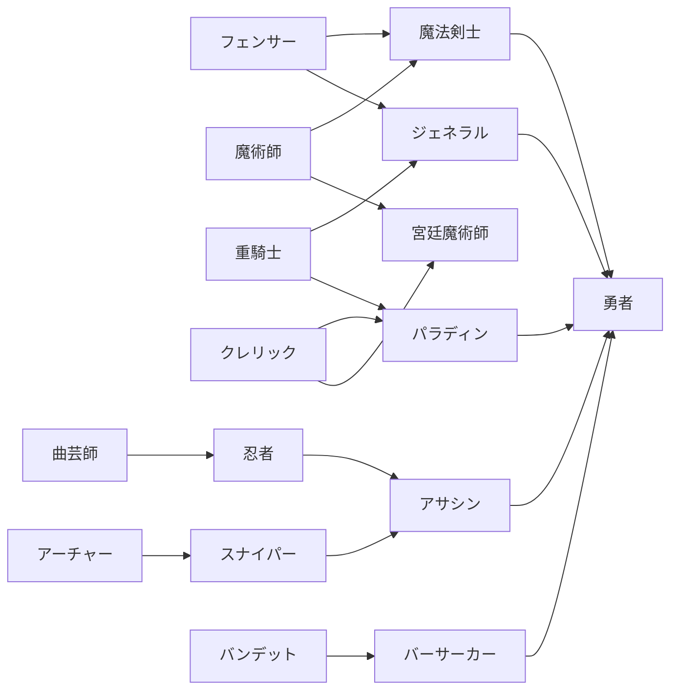

# 無限迷宮アビス：ジョブツリー（v0.23）

> [実装済] 下級6・中級7・複合9・特別1・上級8、計31職。MASTERはジョブLv60で判定。新しいスキル・成長値は暫定。上級の専用スキルは未設計。

通常の「育成 → ジョブ」では下級・中級・複合・特別の23職を表示する。現在上級職に就いているセーブも読み込める。

## 下級6職から中級7職へ

| 中級職 | 必要な下級MASTER |
| --- | --- |
| 重騎士 | ナイト |
| フェンサー | 戦士 |
| 魔術師 | 魔法使い |
| クレリック | ヒーラー |
| アーチャー | 弓使い |
| 曲芸師 | シーフ＋弓使い |
| バンデット | 戦士＋シーフ |

旧「上級職」の7職を中級に変更しただけで、内部ID・ジョブ経験値・MASTER状態は引き継ぐ。

## 中級から複合9職へ

| 複合職 | 必要なMASTER |
| --- | --- |
| 魔法剣士 | フェンサー＋魔術師 |
| ジェネラル | フェンサー＋重騎士 |
| パラディン | 重騎士＋クレリック |
| 宮廷魔術師 | 魔術師＋クレリック |
| スナイパー | アーチャー |
| 忍者 | 曲芸師 |
| アサシン | 忍者＋スナイパー |
| バーサーカー | バンデット |
| 勇者 | 魔法剣士＋パラディン＋ジェネラル＋アサシン＋バーサーカー |

## 特別職・上級職の全職MASTER条件

**グランドマスター：** 下級6＋中級7＋複合9＝全**22職MASTER**。

**上級8職の共通資格**は総合Lv **100,000以上**かつ下級・中級・複合・特別の**全23職MASTER**。この条件は総合Lv上限の1,000,000到達前に満たせる。対象の23職にグランドマスターが入り、条件に循環はない。上級職への転職には専用導線が必要。転職機会を発生させるイベントは未設計。

上級8職：ガーディアン／ウェポンマスター／武士／フロラフルル／ダークナイト／トレジャーハンター／ギャンブラー／賢者。

**注意：** 宮廷魔術師は勇者に直接必要な5職には含まれないが、グランドマスターと上級職の条件には含まれる。

## 更新ルール

転職条件を変更したら、このファイルと [ジョブ・スキル台帳](jobs-and-skills.md)、[決定事項](roadmap-and-decisions.md)、`index.html` を同じ作業で更新する。既存のセーブ済みジョブIDを変更しない。
